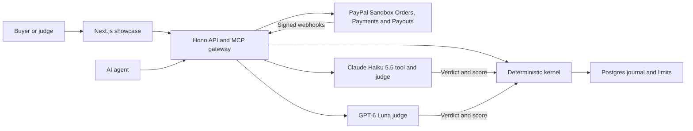

# PASHADHARA

PASHADHARA gives an AI agent a spending budget backed by a PayPal sandbox authorization hold. The gateway checks each tool call against the journal before running it. For escrow jobs, two models judge the deliverable and the kernel calculates the payment from the buyer's rubric.

## Try the demo

Open the showcase lease and choose **Run the agent** to make a real Haiku-backed call while the sandbox authorization and demo budget are available. A successful call commits 3 cents to the journal; PayPal capture is separate. **Check this amount** previews the kernel decision without posting usage or calling a provider. **Proof** shows dated capture fees, PayPal reconciliation and a recorded escrow run. The showcase uses a dedicated sandbox hold and requires no signup. When no live lease is configured or the gateway cannot be reached, the UI labels its saved demo fixture and offers a separate browser simulation. That fixture has no traceable raw run and is not PayPal evidence. [Open the demo](https://pashadhara.vercel.app/lease?showcase=1)

For an agent integration, start with the [developer quickstart](docs/quickstart.md). Lease creation requires an operator bearer. The hosted signup remains a prototype.

Run `node scripts/generate-proof-evidence.mjs` to regenerate the public Proof manifest from the sandbox evidence. Run it with `--check` to verify the checked-in manifest. After building the web app, run `node apps/web/scripts/with-motion-server.mjs scripts/check-proof-evidence.mjs` to compare the rendered page with the source evidence and save screenshots.

## How it works

- PayPal Orders creates the order with `AUTHORIZE` intent and turns the buyer's approval into an authorization. Payments captures from that authorization or voids it. Payouts sends the seller's accrued amount and reads back the batch. The webhook handler verifies signatures and reconciles from a fresh PayPal read.
- Claude Haiku 5.5 summarises text through the metered MCP tool. Haiku 5.5 and GPT-6 Luna independently propose escrow verdicts. The kernel maps their verdicts and scores to a payment using the buyer's fixed rubric and integer cents.
- The showcase labels computed figures from the journal and identifies recorded sandbox data by date. PayPal outputs are measured, and sample flows are labelled fixture. The documented PayPal authorization honor period is 72 hours.



## Run locally

Use Node 24, the workspace-pinned pnpm version, and Docker. Start an isolated Postgres container named `pashadhara-rails-15434`. The helper creates a fresh named database and loads the frozen schema and kernel roles.

```bash
pnpm install --frozen-lockfile
docker run -d --name pashadhara-rails-15434 -p 127.0.0.1:15434:5432 -e POSTGRES_HOST_AUTH_METHOD=trust postgres:15
bash apps/api/scripts/live-db.sh live_local
pnpm -r --if-present typecheck
pnpm --filter @pashadhara/web build
```

For the API service smoke test, also load the schema and roles into the throwaway container's default `postgres` database.

```bash
docker exec pashadhara-rails-15434 psql -U postgres -d postgres -v ON_ERROR_STOP=1 -f /tmp/schema.sql
docker exec pashadhara-rails-15434 psql -U postgres -d postgres -v ON_ERROR_STOP=1 -f /tmp/roles.sql
KERNEL_TEST_DATABASE=live_local pnpm test
```

For the connected demo, copy `.env.example` to `.env`, set `DATABASE_URL` to the local kernel URL printed by the helper, and use sandbox credentials. Follow the showcase setup to create and activate the lease. Then start the API and web app in separate terminals. [Showcase setup](docs/showcase.md)

```bash
# API
node --env-file=.env --import ./apps/api/node_modules/tsx/dist/loader.mjs apps/api/src/local.ts
# Web
PASHADHARA_API_ORIGIN=http://127.0.0.1:3000 pnpm --filter @pashadhara/web dev --port 3100
```

Open `http://127.0.0.1:3100/lease?showcase=1`.

## License

MIT. [LICENSE](LICENSE)
