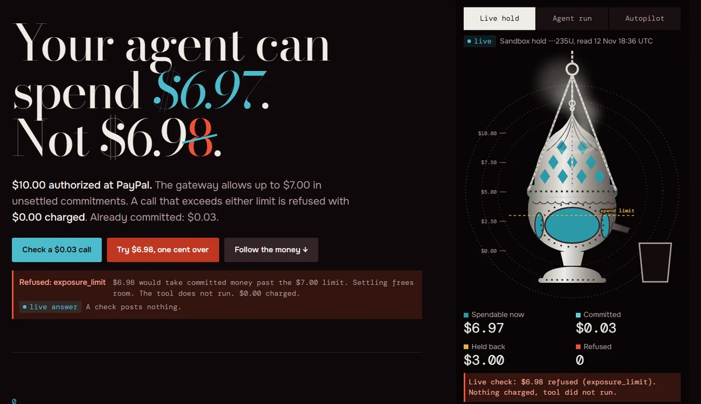
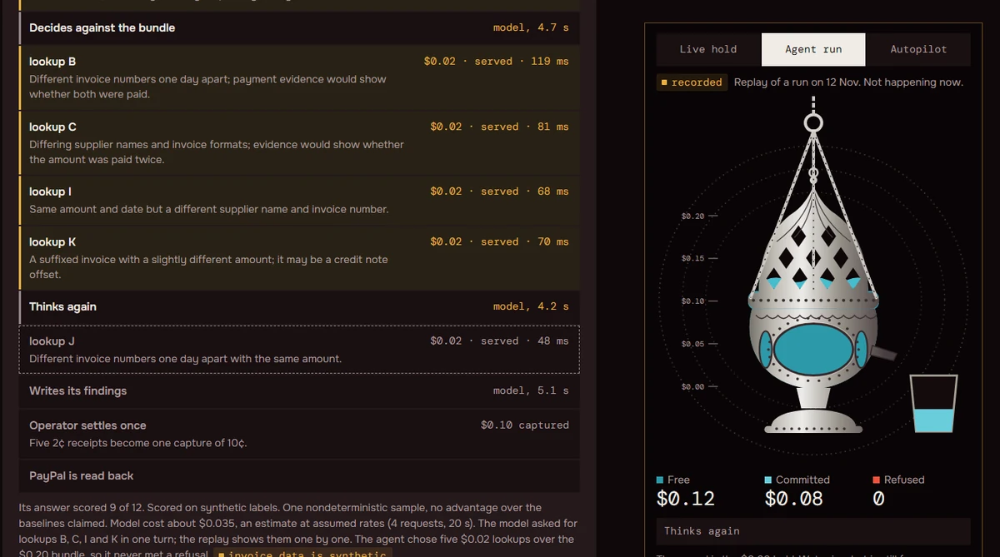
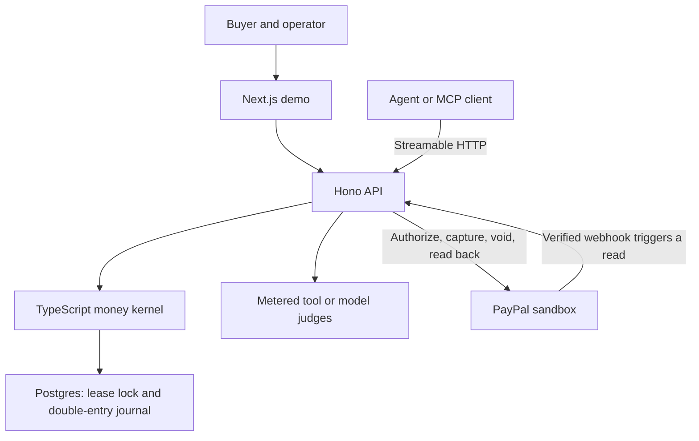
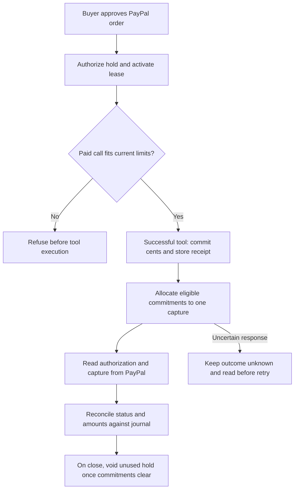

<p align="left"></p>

# PASHADHARA

**An AI agent can choose its tools. A PayPal-backed budget decides what it can spend.**

A buyer approves one PayPal sandbox hold. The agent discovers priced tools over MCP. A deterministic gateway checks every paid call before it runs, records successful calls in a double-entry journal, and later reconciles captures with PayPal.

[](https://pashadhara.vercel.app/) [](https://pashadhara.vercel.app/developers) [](LICENSE)

[Open the demo](https://pashadhara.vercel.app/) · [Watch the recorded agent in the app](https://pashadhara.vercel.app/#s2) · [Inspect the proof](https://pashadhara.vercel.app/proof) · [Connect a client](docs/quickstart.md)

[](https://pashadhara.vercel.app/#s2)

*V5 browser capture from a dated sandbox read. The free preview ran the limit check and posted nothing. The current demo may show a different balance or offer a recorded fallback.*

## See the boundary work

| In the demo | What you are seeing |
| --- | --- |
| [**Live hold**](https://pashadhara.vercel.app/#s2) | A current Postgres snapshot of the PayPal sandbox-backed lease and a free affordability preview while the hold is active. A separately labeled paid summary can commit sandbox usage when enabled. |
| [**Agent run**](https://pashadhara.vercel.app/#s2) | A replay of real Claude Haiku 5.5 tool choices on a 20¢ sandbox hold. The invoices and payment lookup results are synthetic. |
| [**Autopilot**](https://pashadhara.vercel.app/#s2) | A scripted browser simulation. It makes no PayPal request. |
| [**Settle and reconcile**](https://pashadhara.vercel.app/#s3) | Recorded sandbox captures, fees and authorization states shown beside the local journal. |

**Live** describes when a request happened. **Recorded** describes a past run or replay. **Measured** denotes PayPal response fields in the financial proof. **Computed** denotes a gateway, journal or verifier result. **Fixture** denotes synthetic data. **Illustrative** denotes a scripted sequence. A recording can contain all three of a measured hold, computed receipts and fixture invoices.

## The agent chose what to buy

Haiku reviewed **12 synthetic invoice pairs** for duplicate payments. Over MCP it discovered a **20¢ bundle**, **2¢ individual lookups**, and a free budget check. The bundle fit. The model chose lookups **B, C, I, K, and J**, committing **10¢**. One lookup showed that the original payment had been reversed before its replacement settled. The model submitted structured findings and scored **9 of 12** against fixture labels. That is one run on synthetic data.

[](https://pashadhara.vercel.app/#s2)

An operator settled the five commitments in one capture. The journal linked five receipts and five 2¢ allocations to that capture. PayPal sandbox returned **10¢ captured**, **10¢ in fees**, and the **20¢ authorization in partially captured state**. The remaining **10¢ stayed open**. [Recorded replay data and allowlisted PayPal fields](apps/web/components/v5/agent-run.json) · [Investigation and evidence notes](docs/runs/finance-investigation-2026-11-12.md)

A different run shows the hard stop. A **7¢ bundle** on a **6¢ hold** returned `cap_reached` and had no journal group. A separate operator settlement with fixture usage captured **$3.00** on a **$10.00** sandbox hold, recorded a **$0.59** fee, and voided the **$7.00** remainder. [Refusal trace](apps/web/public/finance-paypal-trace.jsonl) · [Refusal journal proof](apps/web/public/finance-paypal-proof.json) · [Settlement and void proof](evidence/settlement-sandbox-20261112.json)

## Architecture



The buyer sets the lease cap and unsettled limit. The server registry sets each tool price. The model chooses the tool and input. The kernel uses **integer USD cents** (`bigint`), checks the live authorization window and balances, and serializes mutations under a **per-lease database lock**. The cap limits total spending against the hold. The unsettled limit caps commitments awaiting capture, so available spend can be lower than the free hold balance. [Money invariants](packages/contract/INVARIANTS.md) · [Usage admission](packages/kernel/src/usage.ts)

### MCP and idempotency

- Connect to **`https://pashadhara.vercel.app/api/mcp`** over Streamable HTTP. The public **Connect** panel can run discovery. An operator provisions a lease, and the client sends its scoped bearer token for calls. [Developer demo](https://pashadhara.vercel.app/#s4)
- Use `initialize` and `tools/list` to discover active tools, their schemas and prices in `_meta`. The deployed showcase lists `summarise` and `check_budget`. The recorded finance run used a registry with finance lookup tools.
- `check_budget` takes a tool name and returns a read-only affordability snapshot. The paid call rechecks the rules under the lock.
- A paid call takes `text` and a fresh UUID in `idempotency_key`. The gateway binds it to the tool and input. A retry of a served call with the same UUID, tool and input returns its stored result with zero additional charge. A retry of a refused call returns the refusal. A changed tool or input with the same UUID is refused. A provider failure rolls back the local commitment. The provider may already have processed the request. [MCP handler](apps/api/src/mcp.ts) · [Meter and result store](apps/api/src/meter.ts)

### From approval to capture



Each served call moves cents from available hold to unsettled commitments in the same database transaction as its stored result. Capture is a later PayPal operation. The capture intent records its allocations, and reconciliation compares the local amounts and statuses with PayPal reads. Signed webhooks are deduplicated by event ID and trigger a fresh read. [PayPal adapter](packages/paypal/src/index.ts) · [Settlement](apps/api/src/settlement.ts) · [Webhook handling](apps/api/src/webhook.ts)

### Escrow

A buyer reserves a job amount from the same lease and fixes the scoring rubric before work starts. After delivery, two model providers independently propose a verdict and score. The kernel derives release, partial payment, void or hold from the rubric and verdicts. An eligible decision can trigger sandbox capture and queue a seller payout. This job path is separate from metered tool settlement. [Escrow view](https://pashadhara.vercel.app/escrow) · [Job flow](apps/api/src/escrow.ts) · [Decision rules](packages/kernel/judge/decision.ts)

## Run locally

Use **Node 24** and **pnpm 11.21.0** (the workspace pin). From the root of the [GitHub repository](https://github.com/nikhil-puri-dev/PASHADHARA), start the web demo without PayPal or model credentials.

```bash
pnpm install --frozen-lockfile
pnpm --filter @pashadhara/web dev --port 3100
```

Open [localhost:3100](http://localhost:3100) for the journey, recorded replay and browser simulation.

For a connected sandbox, use Docker and Bash (Git Bash works on Windows). The helper below resets the named database in the throwaway container. Use a fresh local name.

```bash
docker run -d --name pashadhara-rails-15434 -p 127.0.0.1:15434:5432 \
  -e POSTGRES_HOST_AUTH_METHOD=trust postgres:15
docker exec pashadhara-rails-15434 pg_isready -U postgres
```

Once Postgres reports that it is accepting connections, initialize the database.

```bash
bash apps/api/scripts/live-db.sh live_readme
```

Copy [`.env.example`](.env.example) to `.env`. Use the printed `DATABASE_URL`, local operator and lease-token secrets of at least 32 characters, sandbox credentials, and `API_BASE_URL=http://127.0.0.1:3100/api`. Open the connected demo at `http://127.0.0.1:3100` to match that origin. Follow the [operator provisioning guide](docs/quickstart.md) or [showcase setup](docs/showcase.md). Model-backed tools require provider credentials and can consume provider credits.

```bash
# Terminal 1, from the repository root
node --env-file=.env --import ./apps/api/node_modules/tsx/dist/loader.mjs apps/api/src/local.ts

# Terminal 2
PASHADHARA_API_ORIGIN=http://127.0.0.1:3000 pnpm --filter @pashadhara/web dev --port 3100
```

### Verification

```bash
pnpm contract:schema
pnpm --filter @pashadhara/paypal test
pnpm --filter @pashadhara/api test
node scripts/generate-proof-evidence.mjs --check
```

The schema checks use PGlite. The PayPal adapter tests use fixtures. For the kernel race and property suite, use the disposable Postgres container above. The finance integration test uses a scripted model and PayPal responses with the real MCP and journal paths. Give it a separate fresh database.

```bash
bash apps/api/scripts/live-db.sh live_readme_kernel
KERNEL_TEST_DATABASE=live_readme_kernel pnpm --filter @pashadhara/kernel test

bash apps/api/scripts/live-db.sh live_readme_finance
REPLAY_TEST_DATABASE=live_readme_finance pnpm --filter @pashadhara/api exec \
  tsx --test test/finance-agent.integration.mts
```

## Scope and limits

- **Sandbox pilot.** Hosted signup is a simulation. Real sandbox provisioning is operator-controlled. The public hold can expire or become unavailable. The dated replay remains available.
- **MCP uses lease-scoped bearer tokens.** OAuth-only clients need a compatible intermediary. Client support depends on Streamable HTTP and custom headers.
- **A hold has a window.** The kernel stops new spending when the authorization honor window ends. PayPal capture outcomes can be uncertain. An unresolved response can require operator investigation.
- **Evidence has a boundary.** The demonstrated metered capture was operator-triggered. The run does not establish hosted scheduler execution, live-money operation, or savings on real invoices. This is a sandbox escrow workflow, not a regulated escrow service.

## Repository

| Path | Responsibility |
| --- | --- |
| [`apps/web`](apps/web) | Next.js and React V5 journey, replay and proof views |
| [`apps/api`](apps/api) | Hono on Node, MCP SDK, provisioning, tools, settlement and webhooks |
| [`packages/kernel`](packages/kernel) | TypeScript money rules, Postgres transactions, journal and decisions |
| [`packages/paypal`](packages/paypal) | PayPal sandbox Orders, Payments and Payouts adapter |
| [`packages/contract`](packages/contract) | SQL schema and roles, OpenAPI, invariants and contract tests |
| [`evidence`](evidence) · [`docs/runs`](docs/runs) | Sandbox responses, computed proof and run write-ups |

**MIT** · [License](LICENSE)
